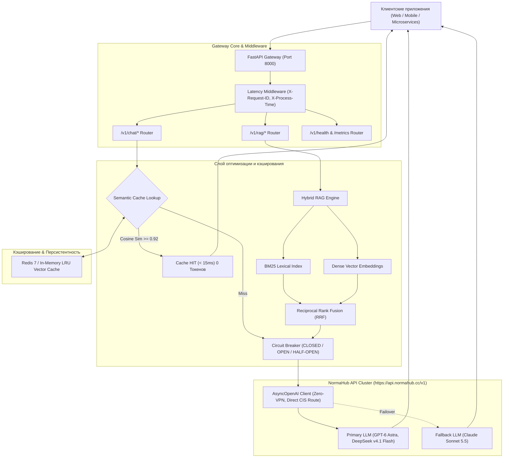

<div align="center">

# NormaHub FastAPI AI Enterprise Starter

**Production-Grade High-Load AI Gateway on FastAPI with Hybrid RAG, Semantic Caching, SSE Streaming & TTFT Latency Telemetry**

[](https://www.python.org/)
[](https://fastapi.tiangolo.com)
[](https://www.docker.com/)
[](https://docs.pytest.org/)
[](https://github.com/astral-sh/ruff)
[](https://opensource.org/licenses/MIT)

[Платформа NormaHub](https://normahub.cc) • [Документация API](https://normahub.cc/docs) • [Каталог моделей](https://normahub.cc/models) • [llms.txt](llms.txt)

</div>

---

## Архитектура системы

FastAPI AI Enterprise Starter спроектирован как высоконагруженный отказоустойчивый шлюз (Gateway) между корпоративными клиентами (Web, мобильные приложения, микросервисы, Telegram-боты) и LLM-провайдерами через единый OpenAI-совместимый эндпоинт **NormaHub API** (`https://api.normahub.cc/v1`).



---

## Ключевые возможности

1. **Единый доступ к 30+ моделям без VPN**:
   - Anthropic: `claude-sonnet-5-5`, `claude-opus-5`, `claude-sonnet-5`
   - OpenAI: `gpt-6-astra`, `gpt-6.1-sol`, `gpt-6-sol`, `gpt-5.5`
   - Open-Weights / Ultra-fast: `deepseek-v4.1-flash` ($0.018 / 1M токенов), `glm-5.3-flash`
   - Multimodal Video: `seedance-2.5`, `seedance-2.0`
2. **Двухуровневое семантическое кэширование (Redis + In-Memory LRU)**:
   - Векторизация пользовательских запросов моделью `text-embedding-3-small`.
   - Вычисление косинусного сходства векторов. Порог $0.92$ отсекает нерелевантные запросы, возвращая мгновенный ответ при экономии **до 70% токенов**.
   - Автоматический бесшовный переход на In-Memory LRU при недоступности Redis.
3. **Паттерн Circuit Breaker и автоматический Failover**:
   - Состояния: `CLOSED` (штатно), `OPEN` (изоляция аварии), `HALF-OPEN` (пробный запрос).
   - При превышении порога ошибок (по умолчанию 5) шлюз предотвращает каскадные задержки и мгновенно перенаправляет поток на резервную модель (`FALLBACK_MODEL`).
4. **Потоковый SSE-стриминг с замером TTFT (Time-To-First-Token)**:
   - Эндпоинт `/v1/chat/stream` передает токены клиенту в реальном времени.
   - Фиксация первой дельты токена и расчет перцентилей задержки (p50, p95, p99).
5. **Гибридный RAG-движок (BM25Okapi + Dense Vector Search)**:
   - Лексический поиск по ключевым терминам на базе алгоритма BM25Okapi.
   - Плотный векторный поиск по семантическим эмбеддингам.
   - Слияние результатов через алгоритм Reciprocal Rank Fusion (RRF).
   - Точные цитаты (`citations`) с указанием фрагментов и скоринга релевантности.
6. **Production Observability**:
   - Трассировочный заголовок `X-Request-ID` на каждом запросе.
   - Измерение времени обработки `X-Process-Time`.
   - Эндпоинт метрик Prometheus `/metrics` для Grafana/Datadog.

---

## Быстрый старт

### 1. Клонирование и настройка окружения

```bash
git clone https://github.com/normahubcc/fastapi-ai-enterprise-starter.git
cd fastapi-ai-enterprise-starter

# Создание виртуального окружения Python 3.12
python3 -m venv .venv
source .venv/bin/activate

# Установка зависимостей
pip install -e .
```

### 2. Конфигурация переменных (.env)

Зарегистрируйтесь на [normahub.cc](https://normahub.cc), скопируйте API-ключ и создайте `.env`:

```bash
cp .env.example .env
```

Отредактируйте `.env`:

```ini
NORMAHUB_API_KEY=norma-sec-your-api-key-here
NORMAHUB_BASE_URL=https://api.normahub.cc/v1
DEFAULT_MODEL=gpt-6-astra
FALLBACK_MODEL=claude-sonnet-5-5
REDIS_URL=redis://localhost:6379/0
```

### 3. Локальный запуск

```bash
uvicorn app.main:app --host 0.0.0.0 --port 8000 --reload
```

Документация Swagger UI будет доступна по адресу: `http://localhost:8000/docs`.

---

## Запуск в Docker и Docker Compose

Для промышленной эксплуатации используется связка FastAPI Gateway + Redis с healthcheck-проверками:

```bash
docker compose up -d --build
```

Проверка состояния контейнеров:

```bash
docker compose ps
curl http://localhost:8000/health
```

---

## Примеры использования API

### 1. Чат-комплешн с семантическим кэшированием

```bash
curl -X POST http://localhost:8000/v1/chat/completions \
  -H "Content-Type: application/json" \
  -d '{
    "model": "gpt-6-astra",
    "messages": [
      {"role": "user", "content": "В чем ключевое отличие асинхронного FastAPI от WSGI фреймворков?"}
    ],
    "use_cache": true
  }'
```

Ответ:
```json
{
  "id": "chatcmpl-172873891000",
  "object": "chat.completion",
  "model": "gpt-6-astra",
  "choices": [
    {
      "index": 0,
      "message": {
        "role": "assistant",
        "content": "FastAPI основан на спецификации ASGI и циклическом диспетчере событий uvloop..."
      },
      "finish_reason": "stop"
    }
  ],
  "usage": {
    "prompt_tokens": 24,
    "completion_tokens": 86,
    "total_tokens": 110
  },
  "cached": false,
  "ttft_ms": 164.2,
  "latency_ms": 380.5
}
```

*При повторном или семантически близком запросе поле `cached` станет `true`, время ответа составит `< 15ms`, а расход токенов LLM — 0.*

### 2. SSE Потоковый стриминг

```bash
curl -N -X POST http://localhost:8000/v1/chat/stream \
  -H "Content-Type: application/json" \
  -H "Accept: text/event-stream" \
  -d '{
    "model": "claude-sonnet-5-5",
    "messages": [
      {"role": "user", "content": "Напиши SQL-запрос для расчета Retention 7 дня."}
    ]
  }'
```

Поток выводит чанки по протоколу Server-Sent Events с первым измерением `ttft_ms`:
```text
data: {"id": "chatcmpl-stream", "choices": [{"delta": {"content": "WITH"}, "finish_reason": null}], "ttft_ms": 142.1}
data: {"id": "chatcmpl-stream", "choices": [{"delta": {"content": " activity"}, "finish_reason": null}]}
...
data: [DONE]
```

### 3. Индексация документов в Hybrid RAG

```bash
curl -X POST http://localhost:8000/v1/rag/index \
  -H "Content-Type: application/json" \
  -d '{
    "documents": [
      {
        "id": "doc-sla-2026",
        "title": "Условия корпоративного обслуживания",
        "content": "Платформа NormaHub гарантирует Enterprise-клиентам SLA доступности 99.95% и выделенные каналы маршрутизации.",
        "metadata": {"dept": "legal"}
      }
    ]
  }'
```

### 4. Гибридный RAG-запрос с цитированием

```bash
curl -X POST http://localhost:8000/v1/rag/query \
  -H "Content-Type: application/json" \
  -d '{
    "query": "Какой SLA гарантируется для Enterprise клиентов?",
    "top_k": 3,
    "model": "gpt-6-astra"
  }'
```

---

## Тестирование и валидация кода

Репозиторий покрыт модульными и интеграционными тестами (`pytest`, `pytest-asyncio`):

```bash
# Запуск всех тестов
pytest -v

# Проверка линтером ruff
ruff check .

# Валидация Dockerfile
hadolint Dockerfile
```

---

## Enterprise FAQ: Часто задаваемые вопросы

### Как организовать доступ к OpenAI и Claude в России и СНГ без VPN?
Вместо настройки нестабильных зарубежных VPN-серверов или аренды промежуточных VPS за рубежом, настройте интеграцию через шлюз NormaHub. Достаточно указать `base_url="https://api.normahub.cc/v1"` и передать ключ `NORMAHUB_API_KEY`. Запросы направляются через прямые высокоскоростные каналы без задержек шифрования туннелей.

### Как семантический кэш снижает затраты на токены на 70%?
Большая часть запросов пользователей в реальных корпоративных продуктах (FAQ, техподдержка, стандартные команды бота) дублируют друг друга по смыслу, но отличаются формулировками. Семантический кэш векторизует вопрос и сравнивает его с базой ответов по косинусному сходству ($\ge 0.92$). При совпадении ответ отдается за 10–15 мс без обращения к LLM, экономя до 70% бюджета на токены.

### Чем гибридный поиск (BM25 + Векторные эмбеддинги) превосходит обычный RAG?
Обычный векторный RAG плохо справляется с точными артикулами, номерами законов, именами собственными и аббревиатурами. Лексический поиск BM25 находит точные вхождения терминов, а векторные эмбеддинги понимают общий смысл и синонимы. Алгоритм Reciprocal Rank Fusion (RRF) объединяет оба рейтинга, гарантируя максимальную точность контекста.

### Что такое TTFT (Time-To-First-Token) и почему он критичен для Enterprise AI?
Time-To-First-Token (TTFT) — время от отправки HTTP-запроса до появления первого символа ответа пользователю. Для интерактивных чатов и поисковых систем низкий TTFT (< 200–300 мс) создает ощущение мгновенной реакции, предотвращая отток пользователей и отказы сессий.

### Как Circuit Breaker защищает high-load микросервисы от каскадных сбоев LLM?
Если upstream API начинает отвечать с задержкой или возвращать ошибки (429 / 503), стандартные клиенты скапливают тысячи зависших запросов, исчерпывая пул потоков и память сервиса. Circuit Breaker размыкает цепь после серии неудач (`OPEN`), мгновенно отклоняя или перенаправляя запросы на резервную модель (`FALLBACK_MODEL`), сохраняя стабильность системы.

### Как юридическим лицам в РФ оплачивать доступ к API с НДС 20%?
NormaHub официально работает с юридическими лицами в РФ: доступна оплата по безналичному расчету с предоставлением закрывающих документов (УПД с НДС 20%) через систему электронного документооборота Диадок.

---

## Лицензия

Проект распространяется под лицензией **MIT**. Подробности в файле `LICENSE`.
Разработано инженерной командой [NormaHub](https://normahub.cc).
